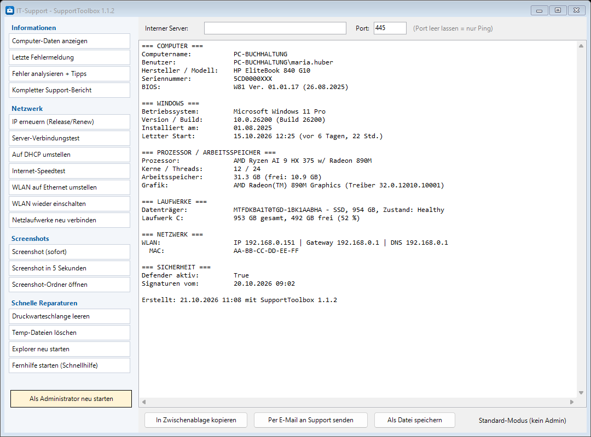

# SupportToolbox

Kleines Support-Tool für Windows-Anwender: Der Kunde startet es per Doppelklick und führt damit die lästigen Standardaufgaben selbst aus – das Ergebnis lässt sich mit einem Klick per Mail an den Support schicken.



**Webseite:** https://fmatsch.ist/SupportToolbox/

## Funktionen

| Bereich | Funktion |
|---|---|
| Informationen | **Computer-Daten** (Modell, Seriennummer, Windows, CPU, RAM, Laufwerke, Netzwerk, Virenschutz) |
| | **Letzte Fehlermeldung** aus dem Windows-Ereignisprotokoll |
| | **Fehleranalyse + Tipps**: wertet die Fehler der letzten 14 Tage aus, erkennt bekannte Muster (Abstürze, Festplatte, Dienste, DNS, WLAN, Updates …) und gibt Hilfe zur Selbsthilfe; prüft zusätzlich Speicherplatz, Neustart-Bedarf, RAM, Defender |
| | **Kompletter Support-Bericht** (alles zusammen) |
| Netzwerk | **IP erneuern** (`ipconfig /release`, `/renew`, `/flushdns`) |
| | **Auf DHCP umstellen**: feste IPv4-Einstellungen (IP, Gateway, DNS) mit einem Klick auf automatisch; alte Werte werden gesichert (Admin). Zeigt danach IP, Gateway, den per DHCP erhaltenen DNS-Server, DNS-Suffix und DHCP-Server |
| | **Internet-Speedtest**: Download, Upload, Ping und Schwankung (Cloudflare), mit Einordnung und Tipps |
| | **Server-Verbindungstest** für interne Server (Name oder IP, optional Port): Router → lokaler DNS-Server → Namensauflösung → Ping → Port, mit Diagnose |
| | **WLAN auf Ethernet umstellen** (nur wenn Kabel verbunden ist) und wieder zurück |
| | **Netzlaufwerke neu verbinden** (inkl. Erreichbarkeitsprüfung des Servers) |
| Screenshots | Sofort oder nach 5 Sekunden, landet in `Bilder\Support-Screenshots` **und** in der Zwischenablage |
| Reparaturen | Druckwarteschlange leeren, Temp-Dateien löschen, Explorer neu starten, Windows-Schnellhilfe (Fernwartung) starten |
| Ausgabe | In Zwischenablage kopieren · **per E-Mail senden** (Outlook, sonst Standard-Mailprogramm) · als Textdatei speichern |

## Benutzung

1. **Einfachste Variante:** `SupportToolbox.exe` aus den [Releases](https://github.com/fmatsch/SupportToolbox/releases/latest) laden und doppelklicken (eine `config.json` daneben legen ist optional). Alternativ: ZIP laden und `Start.bat` starten.
2. `Start.bat` doppelklicken. Für IP erneuern, WLAN umschalten und Druckerdienst wird Administratorrecht benötigt – dafür gibt es links unten den Button **Als Administrator neu starten**.

Voraussetzung: Windows 10/11 mit Windows PowerShell 5.1 (ist enthalten). Keine Installation, keine Abhängigkeiten, es wird nichts ins Internet gesendet.

## Anpassen

`config.example.json` nach `config.json` kopieren und anpassen:

```json
{
  "CompanyName": "Mein IT-Support",
  "SupportMail": "support@meine-firma.de",
  "TestHost": "server.meine-firma.de",
  "TestPort": 445,
  "NetworkDrives": [ { "Letter": "Z", "Path": "\\\\server\\daten" } ]
}
```

- `SupportMail`: Empfänger der „Per E-Mail senden“-Funktion
- `TestHost` / `TestPort`: interner Server (Name oder IP) und Port als Vorgabe für den Server-Verbindungstest (vom Kunden änderbar)
- `NetworkDrives`: optionale zusätzliche Laufwerke, die beim Verbinden mit eingerichtet werden (bereits vorhandene Netzlaufwerke des Benutzers werden automatisch erkannt)

Eigene Fehlermuster für die Analyse lassen sich in `SupportToolbox.ps1` in der Liste `$script:Rules` ergänzen (Provider-Regex, Ereignis-IDs, Tipp-Text).

## Hinweise

- Die .exe wird mit `build.ps1` (ps2exe) aus dem Skript gebaut und ist nicht signiert - Windows SmartScreen oder Virenscanner können deshalb warnen (Weitere Informationen > Trotzdem ausführen).
- Das Skript ist unsigniert. `Start.bat` startet PowerShell mit `-ExecutionPolicy Bypass`, damit es auch aus einer heruntergeladenen ZIP läuft.
- Die Mail enthält Computername, Benutzername und Seriennummer – bitte den Kunden vor dem Senden informieren.
- Tests ohne Oberfläche: `. .\SupportToolbox.ps1 -NoGui` lädt nur die Funktionen (z. B. `Get-SpecsText`).

## Lizenz

MIT – siehe [LICENSE](LICENSE).